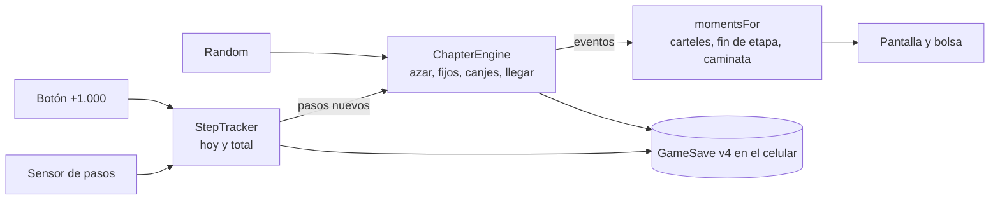

# Gramonia RPG: informe del proyecto

Estado al 23 nov 2026.

## Resumen

Gramonia es un juego de caminata para Android, ambientado en los Cuentos de Gramonia. La jugadora avanza caminando en la vida real, a lo largo de las **8 etapas** del Capítulo 1 ("La pluma del Rocanrón").
- **Cómo se avanza:** en cada etapa hay que juntar objetos que aparecen mientras se camina. Algunos salen al azar, otros fijos cada tantos pasos, y otros se canjean juntando objetos comunes.
- **Cuánto dura:** el capítulo empieza en el jardín de la abuelita y termina cuando zarpa el barco, después de unos **105.000 pasos** (unas 3 semanas a 4.500 pasos por día).

**Estado actual**
- **La app:**
  - Cuenta los pasos reales y hace avanzar las etapas con todas sus mecánicas y textos.
  - Muestra fondos ilustrados y los dibujos de objetos, recompensas y personajes.
  - Tiene la bolsa de objetos y guarda la partida en el celular.
- **Probado en un Xiaomi Redmi 13C:** la lectura de pasos. Las etapas, los dibujos y la bolsa, por ahora, solo con tests y capturas.
- **Calidad:**
  - pasan los 156 tests;
  - `flutter analyze` no da avisos;
  - la auditoría del 23 nov está en `docs/auditoria.md`.
- **Repositorio:** github.com/Ivanknop/gramonia-steps (rama `main`), con 21 commits. Los commits y los push los hace Iván.

## Estado del plan de desarrollo

| # | Parte | Estado |
| --- | --- | --- |
| 1 | App vacía que abre en el celular | ✅ Hecha |
| 2 | Leer los pasos y mostrarlos | ✅ Hecha y probada en un Redmi 13C |
| 3 | Las etapas con su barra y sus objetos | ✅ Hecha (8 etapas). Falta probarla en el celular |
| 4 | Guardado de la partida (etapas e inventario) | ✅ Hecho, con conversión de las partidas viejas (v1, v2 y v3) |
| 5 | Monedas y tienda de mejoras | ⏳ Pendiente |
| 6 | Textos, dibujos y sonidos | 🟡 Textos hechos. Dibujos: 34 de 42 (faltan 8). Sonidos: pendientes |

## Historia de los cambios de diseño

1. **Primera versión:** combate por turnos contra enemigos de Mututu, 30.000 pasos.
2. **Sin combate:** cada etapa se completaba juntando objetos fijos en ciertos pasos, 30.000 pasos.
3. **Capítulo de 100.000 pasos:** objetos al azar con garantía, objetos fijos, canjes y tramos de viaje.
   - En la etapa del barco se ajustaron los números: los bienes salen 1 en 100 (en vez de 1 en 1.000) y la compra cuesta 20 monedas (en vez de 200). Con los números originales, el capítulo duraba unos 234.000 pasos.
4. **Arte (22 y 23 nov):**
   - fondos por etapa con fundido y mapa para los tramos de viaje;
   - dibujos de objetos, recompensas y personajes;
   - cartel "¡Encontraste…!" que vuela a la bolsa, la bolsa y una ventana de fin de etapa.
5. **Jardín (23 nov):** nueva etapa 1, en la que Caperucita, todavía sin caperuza, junta 15 flores amarillas antes de que llegue el mensaje del Hada Madrina. Suma 1.500 pasos.

Las monedas y la tienda vuelven más adelante, para comprar mejoras que ayuden a conseguir más objetos. El diseño vigente está en `docs/diseno.md`: ante una duda de reglas, ese archivo manda.

## Cómo funciona el juego

### Pasos
El sensor del celular (TYPE_STEP_COUNTER) cuenta los pasos desde el último reinicio del celular. La app guarda la última lectura y suma la diferencia.
- La primera lectura es solo la base: los pasos de antes de instalar no cuentan.
- Si la lectura nueva es menor que la anterior, hubo un reinicio y se suma la lectura completa.
- Si una lectura trae más de 50.000 pasos de golpe, es absurda: no se suma y queda como base nueva. **Ojo:** esto puede tirar pasos reales si la app no se abre por muchos días (ver la auditoría, A2).
- A medianoche, los "pasos de hoy" vuelven a 0. El total no se reinicia.

### Mecánicas de los objetos
Son las mismas para todos los objetos; solo cambian los números.

| Mecánica | Regla |
| --- | --- |
| Aparición al azar | Cada K pasos se tira un número del 1 al N; si sale 1, aparece el objeto. |
| Garantía de mala suerte | Si pasan 3×N×K pasos sin que aparezca, sale seguro. |
| Objeto fijo | Sale uno cada M pasos, en orden. |
| Canje | X objetos comunes se cambian solos por el primer objeto de la etapa que falte. |
| Llegar | Tramo de viaje al principio de la etapa, sin objetos. |

- Al juntar todo lo que pide una etapa, se entrega la recompensa y empieza la siguiente.
- Los pasos que sobran pasan a la etapa siguiente. Un salto grande (por ejemplo, al abrir la app después de caminar mucho) recorre todas las tiradas en orden y puede completar varias etapas.
- Un objeto de etapa que ya no hace falta deja de aparecer. Los objetos comunes que sobran quedan en el inventario.
- El botón de debug "+1.000 pasos" avanza todo igual que los pasos reales.

### Qué se ve cuando pasa algo
- **Objeto conseguido (o recibido por un canje):**
  - aparece grande en el centro con "¡Encontraste una flor amarilla!" y su mensaje;
  - a los 1,6 segundos, o al tocarlo, vuela hasta la bolsa, que rebota y suma al número de nuevos.
- **Muchos objetos de golpe:** un cartel por tipo de objeto ("×15"), como mucho 3. Primero van los que pide la etapa; el resto va directo a la bolsa.
- **Gemas:** salen cada 50 pasos, así que no tienen cartel ni suman al número de la bolsa.
- **Fin de etapa:** una ventana con el personaje, la recompensa en grande, el texto final y el botón "¡Seguir!".
- **Caminata:** si la etapa siguiente es en otro lugar y no tiene tramo de viaje, aparece unos segundos la pantalla "Caminando hasta …" con el mapa.
- **Llegada** al final de un tramo de viaje: aviso chico abajo.



## Etapas del Capítulo 1

| # | Etapa | Llegar | Qué hay que juntar | Cómo aparece | Recompensa |
| --- | --- | --- | --- | --- | --- |
| 1 | Un paseo por el jardín | — | 15 flores amarillas | Fijas, una cada 100 | Ramo de flores amarillas |
| 2 | Salir de la casa de la abuelita | — | 15 flores lilas | 1 en 10 cada 50 pasos | Caperuza de aprendiz |
| 3 | El nido del Rocanrón | — | 3 semillas de fuego | Fuego: 1 en 100 cada 200. Agua o hielo: 1 en 10 cada 50. Canje: 10 → 1 de fuego | Pluma del Rocanrón |
| 4 | El laberinto de las hormigas | — | 6 piezas del acertijo | Fijas, una cada 1.000 | Salida a la costa |
| 5 | El puerto | 10.000 | 1 pista | 1 en 100 cada 50 | Pista: "los dragones pueden calmarla" |
| 6 | La montaña dragón | 15.000 | 4 ofrendas | Ofrenda: 1 en 200 cada 100. Gema: fija cada 50. Canje: 100 gemas → 1 ofrenda | Los dragones calman la tormenta |
| 7 | La casa de papá Caperucita | 5.000 | 4 objetos para la mochila | Fijos, uno cada 2.000 | Mochila con insumos |
| 8 | El barco | 5.000 | Madera, clavos, cuerdas, bandera pirata y ancla | Cada bien: 1 en 100 cada 100. Moneda de oro: 1 en 10 cada 50. Canje: 20 monedas → el bien que falte | El barco zarpa |

### Personajes por etapa

| # | Junto a la historia | En la ventana de fin de etapa |
| --- | --- | --- |
| 1 | Caperucita sin caperuza | Hada Madrina (llega su mensaje) |
| 2 | Caperucita sin caperuza | Caperucita con su caperuza |
| 3 | Rocanrón | Rocanrón |
| 4 | Hormigas | Hormigas |
| 5 | Caperucita | Caperucita |
| 6 | Dragones | Dragones |
| 7 | Papá Caperucita | Papá Caperucita |
| 8 | Caperucita | Hada Madrina |

Mientras se camina se ve a Caperucita de espaldas. Los dibujos de las hormigas y de papá Caperucita todavía faltan; en su lugar se ve un ícono genérico.

### Balance: simulación de 1.000 partidas con el motor real

| # | Etapa | Promedio | Suerte (10%) | Mala suerte (90%) |
| --- | --- | --- | --- | --- |
| 1 | Un paseo por el jardín | 1.500 | 1.500 | 1.500 |
| 2 | Salir de la casa de la abuelita | 7.194 | 5.250 | 9.200 |
| 3 | El nido del Rocanrón | 11.931 | 7.800 | 15.700 |
| 4 | El laberinto de las hormigas | 6.000 | 6.000 | 6.000 |
| 5 | El puerto | 14.906 | 10.550 | 22.050 |
| 6 | La montaña dragón | 31.378 | 25.400 | 35.000 |
| 7 | La casa de papá Caperucita | 13.000 | 13.000 | 13.000 |
| 8 | El barco | 19.166 | 13.200 | 26.100 |
| | **Capítulo completo** | **105.076** | **95.050** | **115.450** |

- Son unos 23 días en promedio. 8 de cada 10 partidas terminan entre los 21 y los 26 días.
- La partida más corta de la simulación fue de 84.300 pasos y la más larga de 137.150.
- Para repetir la simulación: `dart run tool/simulate.dart`.
- Un test avisa si el promedio sale del rango de 90.000 a 120.000.

### Cómo ajustar el juego
- **Dónde se cambia:** números, nombres, textos, dibujos y personajes están todos en `lib/data/chapter1.dart`.
- **Qué verifican los tests:**
  - que todo lo que pide cada etapa tenga una forma de aparecer;
  - que los ids no se repitan y que los personajes usados existan;
  - que no haya textos vacíos;
  - que el balance siga en rango.
- **Después de cambiar números:** correr `dart run tool/simulate.dart` y actualizar la tabla de `docs/diseno.md`.
- **No cambiar los `id` ni agregar etapas antes de otras** sin convertir la partida vieja en `lib/logic/game_save.dart`, porque el id y el número de etapa quedan guardados en el celular.

## Dibujos

- **Dónde van los originales:**
  - `arte/objetos/<id>.jpeg` para objetos y recompensas;
  - `arte/personajes/<id>.jpeg` para personajes;
  - `arte/` no va a git.
- **Cómo se convierten:** `python3 tool/convert_art.py`.
  - Saca el fondo blanco, pero solo en la zona clara que toca el borde, así lo blanco de adentro del dibujo queda.
  - Deja el brillo de alrededor semitransparente y recorta lo que sobra.
  - Guarda WebP en `assets/items/` (256×256) y `assets/characters/` (512×512).
- **Para ver qué falta o sobra:** `dart run tool/check_art.dart`.
- **Hoy:** 34 dibujos (unos 920 KB) más los 8 fondos (unos 960 KB). Faltan 8:
  - flor amarilla;
  - ramo de flores, pluma del Rocanrón, salida a la costa, tormenta calmada y barco zarpa;
  - hormigas y papá Caperucita.
- Si falta un dibujo, la app muestra un ícono genérico y sigue andando.
- La lista completa para dibujar, con los `id`, está en `docs/objetos.md`.

## La pantalla

- **Arriba:** los pasos de hoy (en grande) y el total. En la esquina, la **bolsa**, con el número de objetos nuevos sin ver.
- **Avisos de permiso:** "Dar permiso" o "Abrir ajustes". También hay un aviso si el celular no tiene sensor.
- **Etapa actual:** "Etapa N de 8", el nombre, el personaje junto al texto de la historia, la barra y la recompensa (en gris hasta ganarla).
  - Durante un tramo de viaje: el mapa de fondo, "Caminando hasta …", Caperucita de espaldas y una barra con los pasos del tramo.
- **Para juntar:**
  - cada objeto con su dibujo de 48 px: en gris si todavía no hay ninguno, a color con la cantidad ("7 / 15") si ya hay;
  - debajo, "Aparece al azar", "Faltan X pasos" (fijos) o "Aparece al llegar";
  - los canjes, con los dibujos y el contador, por ejemplo [agua][hielo] 4 / 10 → [semilla de fuego].
- **El viaje:** ✓ etapas hechas (con el dibujo de su recompensa), 🚶 la actual y 🔒 las bloqueadas.
- **Al final:** el Hada Madrina, el barco y "¡El barco zarpó!".
- **Debug:** el botón "+1.000 pasos", que aparece solo en las versiones de debug.

**Bolsa:** al tocarla se abre una grilla con todo lo conseguido en el capítulo y la cantidad total, aunque se haya canjeado. Las recompensas van aparte. Al tocar un objeto se ve grande, con:
- para qué sirve (por ejemplo, "Junto con Semilla de hielo, juntá 10 y se cambian por una semilla de fuego");
- en qué etapa se consigue.

## Estructura del código

```
lib/
  main.dart, app.dart        arranque; conecta el controlador con la pantalla
  strings.dart               textos de la pantalla en español
  data/chapter1.dart         etapas, objetos, recompensas, personajes, números y textos
  logic/                     Dart puro, sin Flutter (todo testeado)
    step_state.dart          pasos de hoy, total y última lectura
    step_tracker.dart        lecturas del sensor → pasos (reinicio, día, absurdas)
    chapter.dart             modelo: ItemType, Reward, Character, Spawn, Exchange, Stage, Chapter
    chapter_progress.dart    etapa, pasos, inventario, garantía, lo conseguido y lo nuevo
    chapter_engine.dart      pasos → tiradas, objetos, canjes, etapas y eventos
    game_save.dart           partida completa (v4) + conversión de v1, v2 y v3
    clock.dart               hora actual (reemplazable en tests)
  services/
    step_sensor.dart         sensor (pedometer) y permiso (permission_handler)
    game_storage.dart        guardado con shared_preferences
  ui/
    step_controller.dart     une sensor, lógica, azar y guardado; manda eventos
    home_screen.dart         la pantalla y la cola de carteles
    notices.dart             eventos → carteles, fin de etapa y caminata
    found_item.dart          cartel "¡Encontraste…!" que vuela a la bolsa
    stage_done.dart          ventana de fin de etapa
    bag.dart                 botón de la bolsa y pantalla de la bolsa
    widgets.dart             panel semitransparente y dibujo con ícono genérico
tool/
  simulate.dart              simulación de balance con el motor real
  convert_art.py             arte/ → WebP con transparencia
  check_art.dart             qué dibujos faltan o sobran
test/                        156 tests (datos, lógica, guardado, controlador, pantalla)
docs/                        diseño, informe, auditoría y lista de objetos
```

El código de la app tiene unas 3.300 líneas de Dart, y los tests unas 1.900.

**Paquetes**

| Paquete | Versión | Para qué |
| --- | --- | --- |
| `pedometer` | 4.2.0 | Leer el sensor de pasos |
| `permission_handler` | 13.0.2 | Pedir el permiso y abrir los Ajustes |
| `shared_preferences` | 2.5.6 | Guardar la partida |
| `material_ui` | 1.1.0 | Widgets de Material, que este Flutter trae aparte |
| `flutter_launcher_icons` | 0.14.4 | Generar el ícono de la app (solo al desarrollar) |

**Guardado:** la partida se guarda en la clave `game_save` (versión 4) e incluye:
- los pasos;
- la etapa actual y los pasos dentro de ella;
- el inventario con cantidades;
- la cuenta de la garantía para cada objeto al azar;
- lo conseguido en todo el capítulo y el número de nuevos de la bolsa.

Las recompensas no se guardan: salen de la etapa en la que va la partida. El estado del `Random` tampoco: al abrir la app se empieza con uno nuevo. La garantía igual se respeta, porque su cuenta sí se guarda.

**Conversión de partidas viejas:** se hace sola la primera vez.
- **v1 (solo pasos) y v2 (etapas fijas de 30.000 pasos):** se conservan los pasos y el capítulo se rehace aplicando el total a las reglas actuales.
- **v3 (antes del jardín):** el jardín se da por hecho y la partida sigue en la misma etapa que tenía, que ahora tiene un número más. Si la partida no traía lo conseguido para la bolsa, se toma el inventario.

## Android

- **Identificador de la app:** `ar.gramonia.rpg`. El nombre visible es "Gramonia".
- **Ícono:** adaptativo, con fondo `#60AFE1`.
- **Permisos:** `ACTIVITY_RECOGNITION`, más el de Google para Android 9 o anterior.
- **Sensor:** está declarado como opcional, así que la app se instala aunque el celular no tenga sensor de pasos.
- **Compilación:** `compileSdk = 37`, porque lo pide `permission_handler`. Esto no cambia en qué celulares se puede instalar.
- **Restricciones:** no usa GPS ni internet, y no corre en segundo plano.
- **Firma:** el APK de release todavía se firma con la clave de debug. Hay que cambiarlo antes de repartirlo (auditoría, A1).
- **Tamaño del APK de release:** 49,5 MB el universal. Uno solo para celulares de 64 bits (`--split-per-abi`) pesa unos 18 MB.

## Entorno de desarrollo

- Devcontainer con Ubuntu 24.04, Flutter estable (3.50.1 hoy), JDK 17 y Android SDK de línea de comandos, sin Android Studio.
- El Dockerfile instala Android 37 y 36, build-tools 36, el NDK 28.2 y CMake 3.22.1.
- Para convertir dibujos hacen falta `webp`, `python3-pil`, `python3-numpy` y `python3-scipy`. Se instalaron a mano con `apt`; conviene sumarlos al Dockerfile.
- **Volúmenes que sobreviven a reconstruir el contenedor:** `.gradle`, `.pub-cache`, `.claude` y `.android`.
  - `.android` guarda la clave de debug y la vinculación de adb.
  - La primera vez que se crea ese volumen, `.devcontainer/post-create.sh` restaura la clave desde `.devcontainer/android-keys/debug.keystore`. Esa copia no se sube a git.
  - Sin la misma clave, el celular no acepta actualizaciones de la app y habría que desinstalarla, lo que borra la partida.
- **Comprobación de la clave:** la clave de debug actual tiene SHA-256 `EF:D8:95:21:…:2B:88:66`.

## Probar en el celular

**Instalar el APK sin modo desarrollador**
1. Generarlo con `flutter build apk --debug`. Sale en `build/app/outputs/flutter-apk/app-debug.apk` y pesa unos 200 MB.
2. Copiarlo al celular (por cable, Drive o Telegram) y abrirlo desde la app Archivos.
3. Permitir "instalar apps desconocidas" para esa app y tocar Actualizar. Se instala encima y conserva la partida.
4. Con "+1.000 pasos" se prueba rápido: unas 105 veces completan el capítulo en promedio.

El APK de release universal pesa 49,5 MB (medido el 23 nov; antes de los dibujos pesaba 47 MB). Hoy se firma con la clave de debug, así que sirve como referencia de tamaño, no para repartir.

**Correr con `flutter run` por WiFi**

El contenedor no ve el USB, así que la conexión va por WiFi:
1. En el celular: Opciones de desarrollador → Depuración inalámbrica → "Vincular con código".
2. En la compu: `adb pair IP:PUERTO_DE_VINCULAR CÓDIGO`, y después `adb connect IP:PUERTO_DE_CONEXIÓN`. Son dos puertos distintos.
3. Comprobar con `adb devices` y correr `flutter run`. Cada lectura del sensor aparece en el log como `[pasos] lectura=…`.

**Particularidades del Xiaomi Redmi 13C**
- Para instalar por adb hay que activar "Instalar vía USB" (pide la cuenta Mi) y "Depuración USB (Ajustes de seguridad)".
- Si se apaga la Depuración inalámbrica, el celular se olvida de la vinculación y el puerto cambia.
- El chip MediaTek manda los pasos en tandas de 5 a 10, así que el contador sube a saltos.
- Xiaomi cierra apps en segundo plano. No se pierden pasos, porque se suman al volver a abrir la app.

**Pruebas hechas en el Redmi**

| Prueba | Resultado |
| --- | --- |
| Permiso de actividad física | ✅ |
| Llegan lecturas del sensor | ✅ |
| Se suman los pasos | ✅ |
| Cerrar y volver a abrir mantiene el total y suma lo caminado con la app cerrada | ✅ |
| Reiniciar el celular | ⏳ Pendiente |
| Etapas, dibujos, carteles, bolsa y ventana de fin de etapa | ⏳ Pendiente |
| Conversión de la partida guardada (v3 → v4) | ⏳ Pendiente |

## Limitaciones conocidas

- Los pasos dados con la app cerrada cuentan para el día en que se abre la app, porque el sensor no dice cuándo se dio cada paso. El total igual queda bien.
- Si el celular se reinicia antes de abrir la app, se pierden los pasos dados entre la última lectura y el reinicio.
- Si se juntan más de 50.000 pasos sin abrir la app (y sin reiniciar), se descartan (auditoría, A2).
- El paquete `pedometer` avisa que una versión futura de Flutter no lo va a aceptar. Hoy anda.
- `StepState` choca de nombre con un widget de Material, y `StepController` ya maneja toda la partida: conviene renombrarlos.

## Próximos pasos sugeridos

1. **Probar en el Redmi** todo lo nuevo: el jardín, los carteles, la bolsa, las ventanas de fin de etapa y la conversión de la partida guardada.
2. **Resolver los dos riesgos altos de la auditoría:**
   - keystore de release;
   - tope de pasos que dependa del tiempo.
3. **Dibujar lo que falta**, empezando por la flor amarilla, que es lo primero que ve Regi.
4. **Decidir qué hacer con `docs/`:** sigue en git aunque esté en `.gitignore` (auditoría, M3).
5. **Revisar los textos con Regi** y ajustar nombres o números. Después, repetir la simulación.
6. Monedas y tienda de mejoras.
7. Sonidos, y quizás los GIF animados de los personajes.

## Historial de commits

| Commit | Qué se hizo |
| --- | --- |
| `7aa5d92` | App vacía de Flutter para Android y diseño movido a docs/ |
| `a2f393d` | Lógica de pasos en Dart puro con tests (reinicio, cambio de día, lecturas absurdas) |
| `42965aa` | Guardado de los pasos en el celular y dependencias de sensor y permisos |
| `f83b05c` | Sensor de pasos, permiso ACTIVITY_RECOGNITION y controlador con log de lecturas |
| `257e494` | Pantalla de pasos con avisos de permiso y botón de debug +1.000 |
| `f916495` | Devcontainer con Android 37 y las herramientas que pide Gradle |
| `0db81c6` | Diseño sin combate: etapas que se completan juntando objetos |
| `0692fdf` | Datos del capítulo 1: 7 etapas con sus objetos y recompensas |
| `7dd9766` | Motor de etapas: objetos por umbral, sobrante a la siguiente etapa y fin del capítulo |
| `2ad51b2` | Guardado de la partida con etapas e inventario; convierte la partida vieja de solo pasos |
| `d89837f` | Los pasos reales y el botón de debug avanzan las etapas y generan avisos |
| `910f23f` | Pantalla de etapas: barra, objetos, viaje de 7 etapas y avisos |
| `5600fda` | Clave de debug y vinculación de adb en un volumen, con copia de respaldo |
| `d8c3f5b` | Informe del estado del proyecto |
| `36842bd` | Diseño de 100.000 pasos: objetos al azar, fijos, canjes y tramos de viaje |
| `2430bdd` | Capítulo de 100.000 pasos: objetos al azar con garantía, fijos, canjes y tramos de viaje |
| `6d7e833` | Simulación con el motor real del juego y tablas actualizadas en el diseño |
| `8b92d59` | La herramienta de simulación puede usar print |
| `c63ccd0` | Informe actualizado al capítulo de 100.000 pasos |
| `bde3d5e` | Fondos ilustrados por etapa con fundido, paneles semitransparentes e ícono de la app |
| `138917f` | Caminatas entre etapas |
| (pendiente) | Dibujos, bolsa, ventana de fin de etapa y etapa del jardín |
