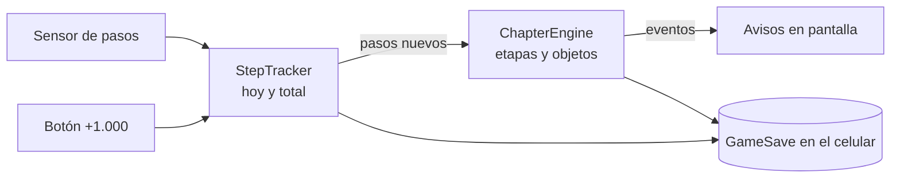

# Gramonia RPG: informe del proyecto

Estado al 22 nov 2026.

## Resumen

Gramonia es un juego de caminata para Android, ambientado en los Cuentos de Gramonia. La jugadora avanza caminando en la vida real. Los pasos llenan las 7 etapas del Capítulo 1 ("La pluma del Rocanrón"), y en cada etapa se juntan objetos al llegar a ciertas cantidades de pasos. El capítulo termina cuando zarpa el barco, a los 30.000 pasos.

- **Hoy:** la app cuenta los pasos reales y avanza las etapas. Junta los 42 objetos, entrega las recompensas y guarda la partida en el celular. La lectura de pasos se probó en un Xiaomi Redmi 13C; la pantalla de etapas, por ahora, solo con tests.
- **Calidad:** 83 tests pasan y `flutter analyze` no da errores.
- **Repositorio:** git local con 13 commits en español y sin repositorio remoto.

## Estado del plan de desarrollo

| # | Parte | Estado |
| --- | --- | --- |
| 1 | App vacía que abre en el celular | ✅ Hecha |
| 2 | Leer los pasos y mostrarlos | ✅ Hecha y probada en un Redmi 13C |
| 3 | Las 7 etapas con su barra y sus objetos | ✅ Hecha. Falta probarla en el celular |
| 4 | Guardado de la partida (etapas e inventario) | ✅ Hecha, junto con la parte 3 |
| 5 | Monedas y tienda de mejoras | ⏳ Pendiente |
| 6 | Textos, dibujos y sonidos | ⏳ Pendiente |

## Cambios de diseño

- **Se sacó el combate.** No hay enemigos, ni Vida/Fuerza/Defensa/Suerte, ni niveles, ni pociones. Cada etapa se completa juntando objetos que se consiguen caminando.
- **Las monedas y la tienda vuelven más adelante.** Van a servir para comprar mejoras que ayudan a conseguir más objetos.
- **La experiencia queda pendiente.** El laberinto con caminos y acertijo de la etapa 3 puede volver como mejora.
- **El diseño vigente está en `docs/diseno.md`.** Ante una duda de reglas, ese archivo manda.

## Cómo funciona el juego

1. **Pasos.** El sensor del celular (TYPE_STEP_COUNTER) cuenta los pasos desde el último reinicio del celular. La app guarda la última lectura y suma la diferencia.
   - La primera lectura es solo la base: los pasos de antes de instalar no cuentan.
   - Si la lectura nueva es menor que la anterior, hubo un reinicio y se suma la lectura completa.
   - Si una lectura trae más de 50.000 pasos de golpe, se toma como absurda: no se suma y queda como base nueva.
   - A medianoche, los "pasos de hoy" vuelven a 0. El total no se reinicia.
2. **Etapas.** Lo que sube el total (por pasos reales o por el botón "+1.000 pasos") se suma a la etapa actual.
   - Al cruzar el umbral de un objeto, el objeto va al inventario.
   - El último objeto de cada etapa está justo en la meta. Al llegar ahí se entrega la recompensa y se destraba la etapa siguiente.
   - Los pasos que sobran pasan a la etapa siguiente. Un salto grande puede completar varias etapas de una vez.
   - Después del final, los pasos solo suman al total.
3. **Avisos.** Cada avance que consigue algo muestra un mensaje abajo de la pantalla.
   - Un objeto suelto: "¡Conseguiste: …!".
   - Una etapa terminada: "¡Terminaste …! Recompensa: …".
   - Muchas cosas de golpe: un resumen.
   - El final: "¡El barco zarpó!".
4. **Guardado.** Todo se guarda en el celular, a lo sumo una vez por segundo y al salir de la app. No hay servidor.



## Etapas del Capítulo 1

| # | Etapa | Pasos | Objetos | Recompensa |
| --- | --- | --- | --- | --- |
| 1 | El árbol mágico | 1.000 | 4 | Caperuza de aprendiz |
| 2 | El nido del Rocanrón | 4.000 | 8 alimentos | Pluma del Rocanrón |
| 3 | El laberinto de las hormigas | 6.000 | 6 piezas del acertijo | Salida a la costa |
| 4 | El puerto | 3.000 | 4 pistas | Pista: "los dragones pueden calmarla" |
| 5 | La montaña dragón | 10.000 | 8 ofrendas | Los dragones calman la tormenta |
| 6 | La casa de papá Caperucita | 2.000 | 4 preparativos | Mochila con insumos |
| 7 | El barco | 4.000 | 8 provisiones | El barco zarpa |

En total son 30.000 pasos y 42 objetos. Los nombres y umbrales de los objetos son una propuesta para revisar. Están en `docs/diseno.md` y en `lib/data/chapter1.dart`.

**Cómo ajustar el juego:**
- Todo se cambia en `lib/data/chapter1.dart`: nombres, pasos y recompensas.
- Un test verifica que el último objeto de cada etapa siga en la meta, que los umbrales vayan en orden y que los ids no se repitan.
- **No cambiar los `id`**, porque son lo que queda guardado en el celular.

## La pantalla

- Los pasos de hoy (en grande) y el total.
- Un aviso si falta el permiso de actividad física, con el botón "Dar permiso". Si el permiso está bloqueado, el botón es "Abrir ajustes". También hay un aviso si el celular no tiene sensor.
- La etapa actual: "Etapa N de 7", el nombre, la barra de progreso, los pasos y la recompensa.
- Los objetos de la etapa: ✓ los conseguidos; el próximo dice "Faltan X pasos" y los demás "A los X pasos".
- El viaje completo: ✓ etapas hechas (con su recompensa), 🚶 la actual y 🔒 las bloqueadas.
- El cartel final "¡El barco zarpó!".
- El botón "+1.000 pasos", que aparece solo en las versiones de debug.

## Estructura del código

```
lib/
  main.dart, app.dart        arranque; conecta el controlador con la pantalla
  strings.dart               textos visibles en español
  data/chapter1.dart         cifras del juego: etapas, objetos, recompensas
  logic/                     Dart puro, sin Flutter (todo testeado)
    step_state.dart          pasos de hoy, total y última lectura
    step_tracker.dart        lecturas del sensor → pasos (reinicio, día, absurdas)
    chapter.dart             estructura de etapas y objetos
    chapter_progress.dart    etapa actual, pasos en ella, inventario
    chapter_engine.dart      pasos → objetos, etapas y eventos
    game_save.dart           partida completa + conversión de la versión vieja
    clock.dart               hora actual (reemplazable en tests)
  services/
    step_sensor.dart         sensor (pedometer) y permiso (permission_handler)
    game_storage.dart        guardado con shared_preferences
  ui/
    step_controller.dart     une sensor, lógica y guardado; manda eventos
    home_screen.dart         la pantalla
    notices.dart             arma el texto de cada aviso
test/                        83 tests: datos, lógica, guardado, controlador, pantalla
docs/diseno.md               diseño del juego
docs/informe.md              este informe
```

El código tiene unas 2.400 líneas de Dart, contando los tests.

**Paquetes**

| Paquete | Versión | Para qué |
| --- | --- | --- |
| `pedometer` | 4.2.0 | Leer el sensor de pasos |
| `permission_handler` | 13.0.2 | Pedir el permiso y abrir los Ajustes |
| `shared_preferences` | 2.5.6 | Guardar la partida |
| `material_ui` | 1.1.0 | Widgets de Material, que este Flutter trae aparte |

**Formato del guardado:** una clave `game_save_v2` con la versión, los pasos y el progreso del capítulo.
- Si el progreso del capítulo falta o está roto, se reconstruye a partir del total de pasos.
- La partida vieja (`step_state_v1`, que tenía solo pasos) se convierte sola la primera vez y después se borra.

## Android

- **Identificador de la app:** `ar.gramonia.rpg`. El nombre visible es "Gramonia".
- **Permisos:** `ACTIVITY_RECOGNITION`, más el de Google para Android 9 o anterior.
- **Sensor:** está declarado como opcional, así que la app se instala aunque el celular no tenga sensor de pasos.
- **Compilación:** `compileSdk = 37`, porque lo pide `permission_handler`. Esto no cambia en qué celulares se puede instalar.
- **Restricciones:** no usa GPS ni corre en segundo plano.

## Entorno de desarrollo

- Devcontainer con Ubuntu 24.04, Flutter estable (3.50.1 hoy), JDK 17 y Android SDK de línea de comandos. No usa Android Studio.
- El Dockerfile instala Android 37 y 36, build-tools 36, el NDK 28.2 y CMake 3.22.1, que es lo que pide Gradle hoy.
- **Volúmenes que sobreviven a reconstruir el contenedor:** `.gradle`, `.pub-cache`, `.claude` y `.android`.
  - `.android` guarda la clave de debug y la vinculación de adb.
  - La primera vez que se crea ese volumen, `.devcontainer/post-create.sh` restaura la clave desde `.devcontainer/android-keys/debug.keystore`. Esa copia no se sube a git.
  - Sin la misma clave, el celular no acepta actualizaciones de la app y habría que desinstalarla, lo que borra la partida.
- **Comprobación de la clave:** la clave de debug actual tiene SHA-256 `EF:D8:95:21:…:2B:88:66`. Es la misma que firmó el APK instalado.

## Probar en el celular

**Instalar el APK sin modo desarrollador**
1. Generarlo con `flutter build apk --debug`. Sale en `build/app/outputs/flutter-apk/app-debug.apk` y pesa unos 200 MB.
2. Copiarlo al celular (por cable, Drive o Telegram) y abrirlo desde la app Archivos.
3. Permitir "instalar apps desconocidas" para esa app y tocar Instalar o Actualizar. Se instala encima de la versión anterior y conserva la partida.

**Correr con `flutter run` por WiFi**

El contenedor no ve el USB, así que la conexión va por WiFi:
1. En el celular: Opciones de desarrollador → Depuración inalámbrica → "Vincular con código".
2. En la compu: `adb pair IP:PUERTO_DE_VINCULAR CÓDIGO`, y después `adb connect IP:PUERTO_DE_CONEXIÓN`. Son dos puertos distintos.
3. Comprobar con `adb devices` y correr `flutter run`. Cada lectura del sensor aparece en el log como `[pasos] lectura=…`.

**Particularidades del Xiaomi Redmi 13C**
- Para instalar por adb hay que activar "Instalar vía USB" (pide la cuenta Mi) y "Depuración USB (Ajustes de seguridad)".
- Si se apaga la Depuración inalámbrica, el celular se olvida de la vinculación y el puerto cambia.
- El chip MediaTek manda los pasos en tandas de 5 a 10, así que el contador sube a saltos.
- Xiaomi cierra apps en segundo plano. No se pierden pasos, porque se suman al volver a abrir la app.

**Pruebas hechas en el Redmi**

| Prueba | Resultado |
| --- | --- |
| Permiso de actividad física | ✅ |
| Llegan lecturas del sensor | ✅ |
| Se suman los pasos | ✅ |
| Cerrar y volver a abrir mantiene el total y suma lo caminado con la app cerrada | ✅ |
| Reiniciar el celular | ⏳ Pendiente |
| La pantalla de etapas | ⏳ Pendiente |

## Limitaciones conocidas

- Los pasos dados con la app cerrada cuentan para el día en que se abre la app, porque el sensor no dice cuándo se dio cada paso. El total igual queda bien.
- Si el celular se reinicia antes de abrir la app, se pierden los pasos dados entre la última lectura y el reinicio.
- El paquete `pedometer` avisa que una versión futura de Flutter no lo va a aceptar. Hoy anda. Si deja de compilar, la alternativa es un lector propio en Kotlin, de unas 50 líneas.
- `StepState` choca de nombre con un widget de Material, y en los tests se resuelve con `hide StepState`. Conviene renombrarlo más adelante.
- El controlador se sigue llamando `StepController`, aunque ya maneja toda la partida.

## Próximos pasos sugeridos

1. Probar el APK nuevo en el Redmi: la pantalla de etapas, los avisos y el botón "+1.000".
2. Revisar los nombres y los umbrales de los objetos.
3. Probar qué pasa al reiniciar el celular.
4. Antes de compartir el APK con otras personas, crear la clave de firma definitiva (keystore de release). Guardarla fuera del repo, con copia de respaldo, y armar el APK de release, que es mucho más liviano.
5. Monedas y tienda de mejoras.
6. Textos, dibujos y sonidos.
7. Opcional: crear un repositorio remoto (por ejemplo, en GitHub) para tener copia del código.

## Historial de commits

| Commit | Qué se hizo |
| --- | --- |
| `7aa5d92` | App vacía de Flutter para Android y diseño movido a docs/ |
| `a2f393d` | Lógica de pasos en Dart puro con tests (reinicio, cambio de día, lecturas absurdas) |
| `42965aa` | Guardado de los pasos en el celular y dependencias de sensor y permisos |
| `f83b05c` | Sensor de pasos, permiso ACTIVITY_RECOGNITION y controlador con log de lecturas |
| `257e494` | Pantalla de pasos con avisos de permiso y botón de debug +1.000 |
| `f916495` | Devcontainer con Android 37 y las herramientas que pide Gradle |
| `0db81c6` | Diseño sin combate: etapas que se completan juntando objetos |
| `0692fdf` | Datos del capítulo 1: 7 etapas con sus objetos y recompensas |
| `7dd9766` | Motor de etapas: objetos por umbral, sobrante a la siguiente etapa y fin del capítulo |
| `2ad51b2` | Guardado de la partida con etapas e inventario; convierte la partida vieja de solo pasos |
| `d89837f` | Los pasos reales y el botón de debug avanzan las etapas y generan avisos |
| `910f23f` | Pantalla de etapas: barra, objetos, viaje de 7 etapas y avisos |
| `5600fda` | Clave de debug y vinculación de adb en un volumen, con copia de respaldo |
