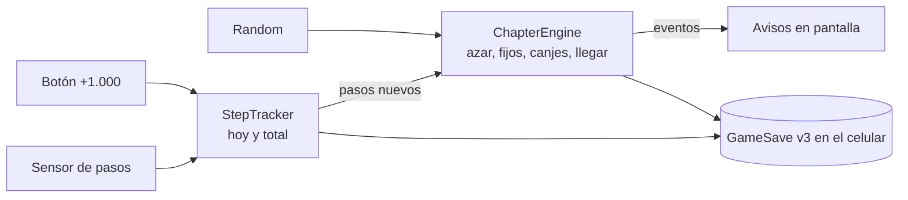

# Gramonia RPG: informe del proyecto

Estado al 22 nov 2026.

## Resumen

Gramonia es un juego de caminata para Android, ambientado en los Cuentos de Gramonia. La jugadora avanza caminando en la vida real. Los pasos llevan a la jugadora por las 7 etapas del Capítulo 1 ("La pluma del Rocanrón"). En cada etapa hay que juntar objetos que aparecen mientras se camina: algunos al azar, otros fijos cada tantos pasos, y otros se canjean juntando objetos comunes. El capítulo termina cuando zarpa el barco, después de unos **100.000 pasos** (unas 3 semanas a 4.500 pasos por día).

- **Hoy:** la app cuenta los pasos reales, hace avanzar las 7 etapas con todas sus mecánicas y textos, y guarda la partida en el celular. La lectura de pasos se probó en un Xiaomi Redmi 13C. Las etapas, por ahora, solo con tests.
- **Calidad:** 113 tests pasan y `flutter analyze` no da errores.
- **Repositorio:** git local con 19 commits en español (contando este informe) y sin repositorio remoto.

## Estado del plan de desarrollo

| # | Parte | Estado |
| --- | --- | --- |
| 1 | App vacía que abre en el celular | ✅ Hecha |
| 2 | Leer los pasos y mostrarlos | ✅ Hecha y probada en un Redmi 13C |
| 3 | Las 7 etapas con su barra y sus objetos | ✅ Hecha con las reglas de 100.000 pasos. Falta probarla en el celular |
| 4 | Guardado de la partida (etapas e inventario) | ✅ Hecho, con migración de las partidas viejas |
| 5 | Monedas y tienda de mejoras | ⏳ Pendiente |
| 6 | Textos, dibujos y sonidos | 🟡 Los textos del capítulo están hechos; faltan los dibujos y los sonidos |

## Historia de los cambios de diseño

1. **Primera versión:** combate por turnos contra enemigos de Mututu, 30.000 pasos.
2. **Sin combate:** cada etapa se completaba juntando objetos fijos en ciertos pasos, 30.000 pasos.
3. **Versión actual:** unos 100.000 pasos, con objetos al azar con garantía, objetos fijos, canjes y tramos de viaje.
   - En la etapa 7 se ajustaron los números: los bienes salen 1 en 100 (en vez de 1 en 1.000) y la compra cuesta 20 monedas (en vez de 200). Con los números originales, el capítulo duraba unos 234.000 pasos.

Las monedas y la tienda vuelven más adelante, para comprar mejoras que ayuden a conseguir más objetos. El diseño vigente está en `docs/diseno.md`: ante una duda de reglas, ese archivo manda.

## Cómo funciona el juego

### Pasos
El sensor del celular (TYPE_STEP_COUNTER) cuenta los pasos desde el último reinicio del celular. La app guarda la última lectura y suma la diferencia.
- La primera lectura es solo la base: los pasos de antes de instalar no cuentan.
- Si la lectura nueva es menor que la anterior, hubo un reinicio y se suma la lectura completa.
- Si una lectura trae más de 50.000 pasos de golpe, es absurda: no se suma y queda como base nueva.
- A medianoche, los "pasos de hoy" vuelven a 0. El total no se reinicia.

### Mecánicas de los objetos
Son las mismas para todos los objetos; solo cambian los números.

| Mecánica | Regla |
| --- | --- |
| Aparición al azar | Cada K pasos se tira un número del 1 al N; si sale 1, aparece el objeto. |
| Garantía de mala suerte | Si pasan 3×N×K pasos sin que aparezca, sale seguro. |
| Objeto fijo | Sale uno cada M pasos, en orden. |
| Canje | X objetos comunes se cambian solos por el primer objeto de la etapa que falte. |
| Llegar | Tramo de viaje al principio de la etapa, sin objetos. |

- Al juntar todo lo que pide una etapa, se entrega la recompensa y empieza la siguiente.
- Los pasos que sobran pasan a la etapa siguiente. Un salto grande (por ejemplo, al abrir la app después de caminar mucho) recorre todas las tiradas en orden y puede completar varias etapas.
- Un objeto de etapa que ya no hace falta deja de aparecer. Los objetos comunes que sobran quedan en el inventario.
- El botón de debug "+1.000 pasos" avanza todo igual que los pasos reales.

### Avisos
- Hay un mensaje en tono de cuento para cada objeto, cada canje, cada llegada y cada fin de etapa.
- Las gemas preciosas (una cada 50 pasos) no tienen aviso propio: se ven en el contador del canje.
- Si pasan muchas cosas juntas, se muestra un resumen.



## Etapas del Capítulo 1

| # | Etapa | Llegar | Qué hay que juntar | Cómo aparece | Recompensa |
| --- | --- | --- | --- | --- | --- |
| 1 | Salir de la casa de la abuelita | — | 15 flores lilas | 1 en 10 cada 50 pasos | Caperuza de aprendiz |
| 2 | El nido del Rocanrón | — | 3 semillas de fuego | Fuego: 1 en 100 cada 200. Agua o hielo: 1 en 10 cada 50. Canje: 10 → 1 de fuego | Pluma del Rocanrón |
| 3 | El laberinto de las hormigas | — | 6 piezas del acertijo | Fijas, una cada 1.000 | Salida a la costa |
| 4 | El puerto | 10.000 | 1 pista | 1 en 100 cada 50 | Pista: "los dragones pueden calmarla" |
| 5 | La montaña dragón | 15.000 | 4 ofrendas | Ofrenda: 1 en 200 cada 100. Gema: fija cada 50. Canje: 100 gemas → 1 ofrenda | Los dragones calman la tormenta |
| 6 | La casa de papá Caperucita | 5.000 | 4 objetos para la mochila | Fijos, uno cada 2.000 | Mochila con insumos |
| 7 | El barco | 5.000 | Madera, clavos, cuerdas, bandera pirata y ancla | Cada bien: 1 en 100 cada 100. Moneda de oro: 1 en 10 cada 50. Canje: 20 monedas → el bien que falte | El barco zarpa |

### Balance: simulación de 1.000 partidas con el motor real

| # | Etapa | Promedio | Suerte (10%) | Mala suerte (90%) |
| --- | --- | --- | --- | --- |
| 1 | Salir de la casa de la abuelita | 7.194 | 5.250 | 9.200 |
| 2 | El nido del Rocanrón | 11.931 | 7.800 | 15.700 |
| 3 | El laberinto de las hormigas | 6.000 | 6.000 | 6.000 |
| 4 | El puerto | 14.906 | 10.550 | 22.050 |
| 5 | La montaña dragón | 31.378 | 25.400 | 35.000 |
| 6 | La casa de papá Caperucita | 13.000 | 13.000 | 13.000 |
| 7 | El barco | 19.166 | 13.200 | 26.100 |
| | **Capítulo completo** | **103.576** | **93.550** | **113.950** |

- Son unos 23 días en promedio. 8 de cada 10 partidas terminan entre los 21 y los 25 días.
- La partida más corta de la simulación fue de 82.800 pasos y la más larga de 135.650.
- Para repetir la simulación: `dart run tool/simulate.dart`.
- Un test avisa si el promedio sale del rango de 90.000 a 120.000.

### Cómo ajustar el juego
- **Dónde se cambia:** números, nombres y textos están todos en `lib/data/chapter1.dart`.
- **Qué verifican los tests:**
  - que todo lo que pide cada etapa tenga una forma de aparecer;
  - que los ids no se repitan;
  - que no haya textos vacíos;
  - que el balance siga en rango.
- **Después de cambiar números:** correr `dart run tool/simulate.dart` y actualizar la tabla de `docs/diseno.md`.
- **No cambiar los `id`** sin migrar la partida vieja, porque son lo que queda guardado en el celular.

## La pantalla

- Los pasos de hoy (en grande) y el total.
- Avisos de permiso: "Dar permiso" o "Abrir ajustes". También hay un aviso si el celular no tiene sensor.
- **Etapa actual:** "Etapa N de 7" y el nombre.
  - Durante el viaje: "Camino a: …", el texto del viaje y una barra con los pasos del tramo.
  - Después: la introducción de la etapa y una barra con los objetos juntados.
- **Para juntar:**
  - cada objeto pedido, con tilde o contador ("3 / 15");
  - debajo, "Aparece al azar", "Faltan X pasos" (fijos) o "Aparece al llegar";
  - el avance de cada canje, por ejemplo "Gema preciosa: 37 / 100 → Escama brillante".
- **El viaje:** ✓ etapas hechas (con su recompensa), 🚶 la actual y 🔒 las bloqueadas.
- El cartel final "¡El barco zarpó!".
- El botón "+1.000 pasos", que aparece solo en las versiones de debug.

## Estructura del código

```
lib/
  main.dart, app.dart        arranque; conecta el controlador con la pantalla
  strings.dart               textos de la pantalla en español
  data/chapter1.dart         etapas, objetos, números y textos del capítulo
  logic/                     Dart puro, sin Flutter (todo testeado)
    step_state.dart          pasos de hoy, total y última lectura
    step_tracker.dart        lecturas del sensor → pasos (reinicio, día, absurdas)
    chapter.dart             modelo: ItemType, RandomSpawn, FixedSpawn, Exchange, Stage
    chapter_progress.dart    etapa actual, pasos, inventario, cuenta de la garantía
    chapter_engine.dart      pasos → tiradas, objetos, canjes, etapas y eventos
    game_save.dart           partida completa (v3) + migración de v1 y v2
    clock.dart               hora actual (reemplazable en tests)
  services/
    step_sensor.dart         sensor (pedometer) y permiso (permission_handler)
    game_storage.dart        guardado con shared_preferences
  ui/
    step_controller.dart     une sensor, lógica, azar y guardado; manda eventos
    home_screen.dart         la pantalla
    notices.dart             arma el texto de cada aviso
tool/simulate.dart           simulación de balance con el motor real
test/                        113 tests (datos, lógica, guardado, controlador, pantalla)
docs/diseno.md               diseño del juego
docs/informe.md              este informe
```

El código tiene unas 3.300 líneas de Dart, contando los tests y la herramienta de simulación.

**Paquetes**

| Paquete | Versión | Para qué |
| --- | --- | --- |
| `pedometer` | 4.2.0 | Leer el sensor de pasos |
| `permission_handler` | 13.0.2 | Pedir el permiso y abrir los Ajustes |
| `shared_preferences` | 2.5.6 | Guardar la partida |
| `material_ui` | 1.1.0 | Widgets de Material, que este Flutter trae aparte |

**Guardado:** la partida se guarda en la clave `game_save` (versión 3) e incluye:
- los pasos;
- la etapa actual y los pasos dentro de ella;
- el inventario con cantidades;
- la cuenta de la garantía para cada objeto al azar.

El estado del `Random` no se guarda: al abrir la app se empieza con uno nuevo. La garantía igual se respeta, porque su cuenta sí se guarda.

**Migración:** las partidas viejas se convierten solas la primera vez y después se borran.
- `step_state_v1` tenía solo pasos; `game_save_v2` tenía las etapas fijas de 30.000 pasos.
- Se conservan los pasos y el total, y el capítulo se rehace aplicando el total de pasos a las reglas nuevas.
- Los objetos viejos (hoja dorada, frutillas, etc.) no se conservan, porque ya no existen.

## Android

- **Identificador de la app:** `ar.gramonia.rpg`. El nombre visible es "Gramonia".
- **Permisos:** `ACTIVITY_RECOGNITION`, más el de Google para Android 9 o anterior.
- **Sensor:** está declarado como opcional, así que la app se instala aunque el celular no tenga sensor de pasos.
- **Compilación:** `compileSdk = 37`, porque lo pide `permission_handler`. Esto no cambia en qué celulares se puede instalar.
- **Restricciones:** no usa GPS ni corre en segundo plano.

## Entorno de desarrollo

- Devcontainer con Ubuntu 24.04, Flutter estable (3.50.1 hoy), JDK 17 y Android SDK de línea de comandos, sin Android Studio.
- El Dockerfile instala Android 37 y 36, build-tools 36, el NDK 28.2 y CMake 3.22.1.
- **Volúmenes que sobreviven a reconstruir el contenedor:** `.gradle`, `.pub-cache`, `.claude` y `.android`.
  - `.android` guarda la clave de debug y la vinculación de adb.
  - La primera vez que se crea ese volumen, `.devcontainer/post-create.sh` restaura la clave desde `.devcontainer/android-keys/debug.keystore`. Esa copia no se sube a git.
  - Sin la misma clave, el celular no acepta actualizaciones de la app y habría que desinstalarla, lo que borra la partida.
  - El volumen se activa al reconstruir el contenedor; eso todavía no se probó.
- **Comprobación de la clave:** la clave de debug actual tiene SHA-256 `EF:D8:95:21:…:2B:88:66`. Es la misma que firmó el APK instalado y el APK nuevo.

## Probar en el celular

**Instalar el APK sin modo desarrollador**
1. Generarlo con `flutter build apk --debug`. Sale en `build/app/outputs/flutter-apk/app-debug.apk` y pesa unos 200 MB.
2. Copiarlo al celular (por cable, Drive o Telegram) y abrirlo desde la app Archivos.
3. Permitir "instalar apps desconocidas" para esa app y tocar Actualizar. Se instala encima y conserva la partida.
4. Con "+1.000 pasos" se prueba rápido: unas 104 veces completan el capítulo en promedio.

**Correr con `flutter run` por WiFi**

El contenedor no ve el USB, así que la conexión va por WiFi:
1. En el celular: Opciones de desarrollador → Depuración inalámbrica → "Vincular con código".
2. En la compu: `adb pair IP:PUERTO_DE_VINCULAR CÓDIGO`, y después `adb connect IP:PUERTO_DE_CONEXIÓN`. Son dos puertos distintos.
3. Comprobar con `adb devices` y correr `flutter run`. Cada lectura del sensor aparece en el log como `[pasos] lectura=…`.

**Particularidades del Xiaomi Redmi 13C**
- Para instalar por adb hay que activar "Instalar vía USB" (pide la cuenta Mi) y "Depuración USB (Ajustes de seguridad)".
- Si se apaga la Depuración inalámbrica, el celular se olvida de la vinculación y el puerto cambia.
- El chip MediaTek manda los pasos en tandas de 5 a 10, así que el contador sube a saltos.
- Xiaomi cierra apps en segundo plano. No se pierden pasos, porque se suman al volver a abrir la app.

**Pruebas hechas en el Redmi**

| Prueba | Resultado |
| --- | --- |
| Permiso de actividad física | ✅ |
| Llegan lecturas del sensor | ✅ |
| Se suman los pasos | ✅ |
| Cerrar y volver a abrir mantiene el total y suma lo caminado con la app cerrada | ✅ |
| Reiniciar el celular | ⏳ Pendiente |
| Pantalla de etapas, avisos y migración de la partida vieja | ⏳ Pendiente |

## Limitaciones conocidas

- Los pasos dados con la app cerrada cuentan para el día en que se abre la app, porque el sensor no dice cuándo se dio cada paso. El total igual queda bien.
- Si el celular se reinicia antes de abrir la app, se pierden los pasos dados entre la última lectura y el reinicio.
- El paquete `pedometer` avisa que una versión futura de Flutter no lo va a aceptar. Hoy anda. Si deja de compilar, la alternativa es un lector propio en Kotlin, de unas 50 líneas.
- Los mensajes de fin de etapa son largos para un aviso abajo de la pantalla: duran más, pero tal vez queden mejor en una ventana propia.
- `StepState` choca de nombre con un widget de Material, y en los tests se resuelve con `hide StepState`. Conviene renombrarlo más adelante.
- El controlador se sigue llamando `StepController`, aunque ya maneja toda la partida.

## Próximos pasos sugeridos

1. Instalar el APK nuevo en el Redmi y probar:
   - la pantalla de etapas, los avisos y los canjes;
   - el botón "+1.000";
   - que la partida vieja se convierta bien.
2. Revisar los textos con Regi y ajustar nombres o números. Después, repetir la simulación.
3. Probar qué pasa al reiniciar el celular.
4. Antes de compartir el APK con otras personas, crear la clave de firma definitiva (keystore de release). Guardarla fuera del repo, con copia de respaldo, y armar el APK de release, que es mucho más liviano.
5. Monedas y tienda de mejoras.
6. Dibujos y sonidos.
7. Opcional: crear un repositorio remoto (por ejemplo, en GitHub) para tener copia del código.

## Historial de commits

| Commit | Qué se hizo |
| --- | --- |
| `7aa5d92` | App vacía de Flutter para Android y diseño movido a docs/ |
| `a2f393d` | Lógica de pasos en Dart puro con tests (reinicio, cambio de día, lecturas absurdas) |
| `42965aa` | Guardado de los pasos en el celular y dependencias de sensor y permisos |
| `f83b05c` | Sensor de pasos, permiso ACTIVITY_RECOGNITION y controlador con log de lecturas |
| `257e494` | Pantalla de pasos con avisos de permiso y botón de debug +1.000 |
| `f916495` | Devcontainer con Android 37 y las herramientas que pide Gradle |
| `0db81c6` | Diseño sin combate: etapas que se completan juntando objetos |
| `0692fdf` | Datos del capítulo 1: 7 etapas con sus objetos y recompensas |
| `7dd9766` | Motor de etapas: objetos por umbral, sobrante a la siguiente etapa y fin del capítulo |
| `2ad51b2` | Guardado de la partida con etapas e inventario; convierte la partida vieja de solo pasos |
| `d89837f` | Los pasos reales y el botón de debug avanzan las etapas y generan avisos |
| `910f23f` | Pantalla de etapas: barra, objetos, viaje de 7 etapas y avisos |
| `5600fda` | Clave de debug y vinculación de adb en un volumen, con copia de respaldo |
| `d8c3f5b` | Informe del estado del proyecto |
| `36842bd` | Diseño de 100.000 pasos: objetos al azar, fijos, canjes y tramos de viaje |
| `2430bdd` | Capítulo de 100.000 pasos: objetos al azar con garantía, fijos, canjes y tramos de viaje |
| `6d7e833` | Simulación con el motor real del juego y tablas actualizadas en el diseño |
| `8b92d59` | La herramienta de simulación puede usar print |
| (este) | Informe actualizado |
